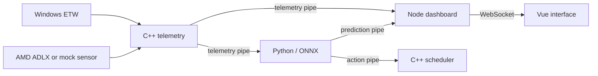

# NeuroPace RDNA

Experimental Windows telemetry and scheduling tools for AMD Radeon systems.

NeuroPace collects ETW DPC/ISR durations and AMD ADLX metrics, runs a 28-feature ONNX classifier, and exposes a local dashboard. The model is trained on synthetic data. Predictive accuracy and improvements to game performance have not been established with reproducible game recordings.

## Current capabilities

- C++ telemetry collector with ETW and optional ADLX support.
- Python feature extraction, ONNX inference and named-pipe output.
- Experimental process affinity and thread priority adjustments with timed rollback.
- Local Node/Vue dashboard for telemetry, logs and module control.
- Offline analysis of measured frametime CSV files.

GPU power control is currently unavailable. The former implementation passed watts to an ADLX API that expects percentages; it has been disabled pending a tested, device-specific implementation. Recommendations are not evidence that an action was executed.

ADLX FPS is a driver counter. The displayed frame interval is its reciprocal, not a recording of individual present events. Use measured frametimes for percentile or stutter analysis. A build without ADLX emits simulated GPU metrics; it must not be used as performance evidence.

## Architecture



## Development setup

Requires Windows 10/11, Python 3.11+, Node.js 20+, CMake 3.25+, Visual Studio C++ build tools and vcpkg. ETW kernel tracing requires an elevated terminal.

```powershell
git clone https://github.com/l1ve709/NeuroPace-RDNA.git
cd NeuroPace-RDNA
python -m pip install -r ai-engine/requirements.txt
Push-Location dashboard
npm ci
Pop-Location

# Set VCPKG_ROOT to an existing, bootstrapped vcpkg checkout.
.\scripts\build-all.ps1
```

For hardware GPU metrics, pass the AMD ADLX SDK directory:

```powershell
.\scripts\build-all.ps1 -AdlxSdkDir "C:/SDKs/ADLX"
```

Generate a demonstration ONNX model from the included synthetic dataset:

```powershell
python ai-engine/training/train_rf.py
```

The tracked pickle is not used by the runtime. Do not deserialize untrusted pickle files. Online retraining is disabled by default because its threshold-derived labels are not independently measured outcomes.

Start components in separate terminals:

```powershell
# Development telemetry
python scripts/mock-telemetry.py

# Inference (waits for telemetry)
python ai-engine/src/main.py

# Dashboard
node dashboard/server/index.js
```

Open http://127.0.0.1:3200. For real telemetry, replace the mock publisher with `telemetry/build/Release/neuropace-telemetry.exe`. The actuator is experimental and can be launched separately from `actuator/build/Release/neuropace-actuator.exe`; it scans its configured game list. It does not currently accept a target PID command-line option.

## Verification

```powershell
python -m pytest -q ai-engine/tests
Push-Location dashboard
npm run check
npm audit --omit=dev
Pop-Location
ctest --test-dir telemetry/build -C Release --output-on-failure
ctest --test-dir actuator/build -C Release --output-on-failure
```

See [session analysis](docs/session-analyzer.md), [benchmark requirements](docs/benchmarks.md), [implementation boundaries](docs/technical-manifesto.md), and [security](SECURITY.md).

## Limitations

Sampling intervals are targets, not timing guarantees. The classifier's risk score and heuristic factor labels do not establish the cause of a stutter. GPU support depends on the driver and ADLX interfaces available on the machine. No blanket anti-cheat compatibility or malware-free certification is claimed; review the source and verify binaries against checksums published with the exact release.

## License

[MIT](LICENSE).
